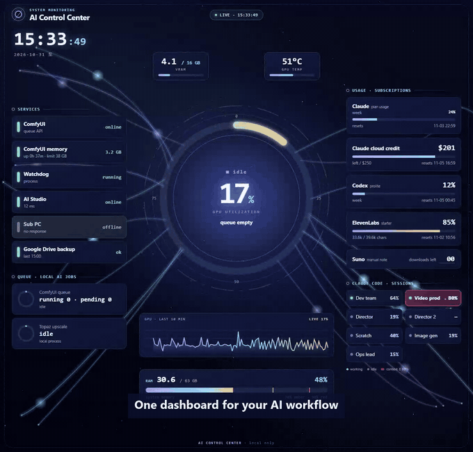
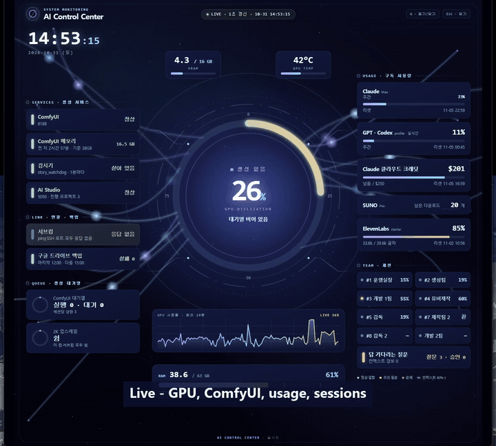

# AI Control Center

[English](README.md) · 한국어

**내 AI 작업실은 내 방식대로.**
내 PC로 AI 영상·이미지를 만들고 Claude Code 세션 여러 개로 일하는 사람을 위한 로컬 관제 화면입니다. ComfyUI 작업, GPU·VRAM·RAM, 세션별 컨텍스트 추정치, Claude·Codex 사용량을 한 화면에 모았습니다. **HTML 화면 하나 + 작은 파이썬 브리지**이고, Claude나 Codex로 고쳐 쓰라고 만든 출발점입니다.



*제작자 PC의 실제 값입니다(세션 이름만 영어 별칭). 세션 하나가 실제로 컨텍스트 80%에 도달해서 기본 기준대로 카드가 빨갛게 바뀌었습니다. 이 녹화에서는 ComfyUI 대기열이 비어 있어서, 작업 중인 모습은 아래 녹화에 있습니다.*



*제작자가 쓰는 한국어판 녹화: ComfyUI 작업이 시작되고(종류·해상도·경과·예상 끝), 세션 카드를 한 번 누르면 Claude 앱에서 그 대화가 열립니다. 개인 대화 목록은 흐리게 처리했습니다. [소리 포함 MP4](assets/demo-session-open.mp4)*

---

## AI에게 설치시키기 (추천)

내 PC의 파일을 읽고 명령을 실행할 수 있는 코딩 AI(예: **Claude Code**, **Codex**)에 저장소 주소를 주고 이렇게 붙여 넣으세요:

```text
https://github.com/HARRYFORCE/ai-control-center 이 저장소를 내 PC에 설치하고, 프로젝트 안내를 읽어
내 환경에서 가능한 기능을 연결해 실행해 주세요. 연결하지 못한 항목은 이유를 알려 주세요.
마지막으로 바탕화면 아이콘을 만들어, 누르면 주소창 없는 창으로 뜨게 해 주세요.
이후 디자인과 패널은 제 취향에 맞게 바꾸겠습니다.
```

설치가 끝나면 **바탕화면 아이콘 하나**로 켭니다. 누르면 주소창 없는 전용 창으로 관제 화면이 뜹니다(브리지는 필요할 때 자동으로 켜짐).

이게 원래 쓰는 방법입니다. 그다음은 계속 말로 시키면 됩니다. **디자인, 구성요소 배치, 카드 삭제·추가, 표시 내용, 경고 기준 전부 본인 취향대로 AI 바이브코딩(Claude, Codex 추천)으로 바꾸세요.** 아까워할 부분은 없습니다.

> 중요한 건 «내 PC에 접근할 수 있느냐»입니다. AI가 내 PC의 파일을 읽고 명령을 실행할 수 있는 도구가 있어야 합니다. 로그인·API 키·어떤 서비스를 켤지 같은 선택은 여전히 내가 합니다.

## 화면에 나오는 것

| 칸 | 내용 |
|---|---|
| **Claude Code 세션** | 세션마다 마지막 기록 기준 컨텍스트 추정치(최근 최대 8개). **80%**부터 빨강(변경 가능). |
| **원클릭 열기** | 카드를 누르면 Claude 데스크톱 앱에서 그 대화가 열림(Windows, 제작자 환경에서 확인). |
| **ComfyUI가 만드는 것** | 영상·이미지·업스케일 구분, 출력 이름, MP, 경과 시간, 지난 성공 작업으로 계산한 예상 끝. |
| GPU·VRAM·온도·RAM | 실시간, 최근 10분 GPU 그래프, 호박색 → 빨강 경고. 가상 메모리는 위험할 때만 경고. |
| ComfyUI 메모리·로컬 작업 | ComfyUI 프로세스 메모리와 켠 시간, Topaz 업스케일 같은 뒤에서 도는 작업. |
| 사용량 | Claude 요금제(선택)·클라우드 크레딧, Codex(창 두 개), ElevenLabs(내 키), Suno는 손으로 적는 메모. |
| 내 것 | HTTP 상태 확인, 로컬 프로세스, 렌더 PC 연결, 마지막 백업 시각. |
| 시계·부팅 효과음 | 옆 모니터용 큰 시계, 켤 때 짧은 효과음(`localStorage.setItem("acc.bootSound","0")`으로 끔). |

값이 없거나 오래되면 `—`나 `stale`로 나옵니다. 지어낸 숫자는 없습니다.

## 바탕화면에 관제실처럼 띄워 두기

Windows에서는 **`start.bat`**을 두 번 누르면 됩니다. 브리지를 켜고(이미 켜져 있으면 건너뜀) 주소창 없는 전용 창으로 화면을 엽니다. 바탕화면에 바로가기를 만들어 두거나, `shell:startup` 폴더에 넣으면 윈도우를 켤 때마다 자동으로 뜹니다. 창 위치·크기·전체 화면은 파일 맨 위 세 줄에서 바꿉니다.

또는 AI에게 시키세요:

```text
AI Control Center를 바탕화면 아이콘으로 만들어 줘. 누르면 브리지가 켜지고 주소창 없는 창으로
내 두 번째 모니터에 전체 화면으로 뜨게. 윈도우 시작할 때 자동으로 켜지게도 해 줘.
```

## 직접 실행

```bash
python bridge.py        # Python 3.9 이상, Windows에서는 추가 설치 없음
```

**http://127.0.0.1:8790/** 을 엽니다. 설정은 `config.example.json`을 `config.json`으로 복사해서 고칩니다. **Windows 11 + NVIDIA + Claude 데스크톱 앱**에서 만들었고, 다른 환경은 손봐야 합니다(AI가 해 줍니다).

더 보기: [AI 프롬프트](docs/AI_CUSTOMIZATION_PROMPTS.md) · [세션 컨텍스트 %와 원클릭 열기 원리](docs/HOW_IT_WORKS.md) · [공개·보안 점검표](docs/SECURITY_RELEASE_CHECKLIST.md)

## 개인정보

- 내 PC에서만 돕니다. 브리지는 `127.0.0.1`에서만 열리고 화면·`assets/`·자기 JSON만 내보냅니다. 다른 Host·Origin으로 온 요청은 거절합니다.
- 네트워크 요청은 켠 것만: 내 서비스 확인, Codex CLI를 통한 Codex 사용량, 내 키로 ElevenLabs, Claude 요금제 사용량(기본 꺼짐, 공개 문서 없는 주소라 막힐 수 있음).
- `config.json`은 git에 안 올라갑니다(내 경로·이름이 들어 있음). 키·토큰은 절대 커밋하지 마세요.

개인 비공식 프로젝트이며 Anthropic·OpenAI·NVIDIA·ComfyUI·ElevenLabs·Suno와 관계없습니다.

## 라이선스

MIT © HARRYFORCE — [LICENSE](LICENSE) 참고.
